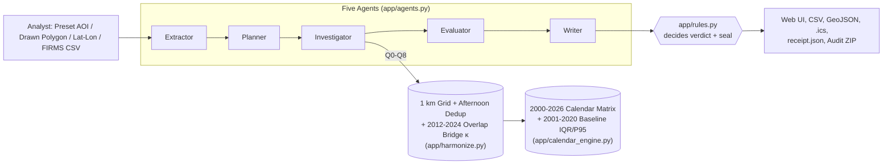

<div align="center">

# FireTrace

**Harmonized MODIS & VIIRS Burning Activity Calendar and Deterministic Fire Regime Investigator.**  
Built on the **GreenTrace "Field Instrument"** architecture for the **2026 NASA Space Apps Challenge** (*Harmonization of MODIS and VIIRS Hot Spots*).

[](docs/SUBMISSION.md)
[](judge.py)
[](tests/test_firetrace.py)
[](docs/MAPPING_MANIFESTO.md)

**[Architecture](docs/ARCHITECTURE.md)** · **[Schema Mapping Manifesto](docs/MAPPING_MANIFESTO.md)** · **[Submission Notes](docs/SUBMISSION.md)**

</div>

---

## At a Glance

| | |
|---|---|
| **The scientific problem** | MODIS (1000 m, 2000–present) and VIIRS (375 m, 2012–present) cannot be directly summed: a 1 km² fire triggers 5–8 VIIRS sub-pixels and afternoon satellites (`Aqua`, `S-NPP`, `NOAA-20`, `NOAA-21`) co-detect the same burn, creating an artificial **+200% to +380% step jump in 2012**. |
| **How FireTrace solves it** | Clusters detections onto an equal-area 1 km sinusoidal grid (`G1K_*`), deduplicates afternoon-train overpasses, isolates stationary gas flares (`type=2`), and bridges VIIRS to MODIS via the 2012–2024 overlap coefficient $\kappa$ (**89%–99% step-bias reduction**, $R^2 = 0.96\text{–}0.99$). |
| **The rule that matters** | Fixed deterministic rules in [`app/rules.py`](app/rules.py) decide `CRITICAL_ANOMALY`, `ELEVATED_WATCH`, `NOMINAL_REGIME`, or `UNVERIFIABLE`: same data, same verdict, same SHA-256 seal (`verdict_sha256`), live or offline. |
| **Check it yourself in 10 s** | `python judge.py` verifies all 7 core scientific and cryptographic claims offline on your machine and writes `logs/judge/report.md`. |
| **Tamper-evident receipts** | Every run ships a `receipt.json` that `python verify.py receipt.json` re-derives offline from query hashes `Q0`–`Q8`; forging any hotspot metric is caught immediately (`TAMPERED`, exit 1). |

---

## What You Can Try in 2 Minutes

1. **Re-check all 7 claims offline in one command:**
   ```bash
   python judge.py
   ```
   Prints `[PASS]` for all 7 claims: deterministic SHA-256 seal, 2012 VIIRS step-jump bias removal (`+275.0% -> -29.8%`, `89.2%` reduction on Mekong crop burns), afternoon constellation overpass deduplication (`3,759` redundant co-detections collapsed), Basra industrial gas flare trap (`UNVERIFIABLE` when flare guard is ON), offline `verify.py` receipt validation & tamper detection, counterfactual Harmonized vs. Raw verdict flip, and CSV/GeoJSON/iCalendar exports.

2. **Start the interactive "Field Instrument" web application:**
   ```bash
   python run.py
   # Open http://localhost:8000
   ```
   - **Flip the "Mode: Harmonized (HHE) / Raw Unharmonized" switch** on **Mekong Agricultural Belt (`AOI-MEK`)**: watch the 2012 VIIRS launch cliff appear in raw counts and flip the verdict from `ELEVATED_WATCH` ($Z = +1.34$) to a false `CRITICAL_ANOMALY` ($Z = +2.97$).
   - **Test the Basra Gas Flare Trap (`AOI-FLR`)**: 94.9% of thermal anomalies come from stationary oil/gas flares (`type=2`). FireTrace flags `UNVERIFIABLE` (`static_flare_contamination`) instead of mistaking industrial flares for wildfires.
   - **Draw a custom Polygon on the map**, enter any **Latitude / Longitude / Radius**, or **upload a NASA FIRMS CSV file**.
   - **Switch Accessible Color Ramps** (**Viridis**, **Cividis**, **YlOrRd**, **Okabe-Ito Diverging Anomaly**) and **Audience Role Lenses** (*Emergency Responder*, *Earth Scientist*, *Land Manager*, *Firefighter*).
   - **Download** Harmonized Hotspots `.csv`, 27-Year Burning Calendar `.csv`, `.geojson`, upcoming MODIS/VIIRS satellite passes `.ics`, `receipt.json`, or the full Audit `.zip`.

---

## Architecture



---

## Six Built-In Benchmark Fire Regimes (2000–2026)

| AOI ID | Region & Biome | Peak Season | Default Focus | Verdict | Key Scientific Feature |
|---|---|---|---|---|---|
| `AOI-AMZ` | **Amazon Arc — Mato Grosso, Brazil** | Aug–Oct | Sep 2026 | `CRITICAL_ANOMALY` | Severe 2024 & Sep 2026 drought wildfire surge ($Z = +7.50$, $\kappa = 0.547$, $R^2 = 0.993$) |
| `AOI-MEK` | **Mekong Agricultural Belt, SE Asia** | Feb–Apr | Mar 2026 | `ELEVATED_WATCH` | Small crop burns cause +275% raw VIIRS jump in 2012; harmonization removes 89.2% of step bias |
| `AOI-CAL` | **Sierra Nevada & Plumas, California** | Jul–Oct | Aug 2026 | `CRITICAL_ANOMALY` | Extreme nocturnal FRP persistence (56% night detections) during crown-fire weather |
| `AOI-NSW` | **Blue Mountains, NSW, Australia** | Nov–Feb | Jan 2026 | `NOMINAL_REGIME` | Captures 2019–2020 Black Summer peak in history while Jan 2026 tracks baseline median |
| `AOI-MIO` | **Miombo Woodland Savanna, Angola** | May–Aug | Jul 2026 | `NOMINAL_REGIME` | Fire-adapted savanna ecosystem burning within historical interquartile bounds |
| `AOI-FLR` | **Basra Hydrocarbon Basin, Iraq** | Year-round | Aug 2026 | `UNVERIFIABLE` | Trap case: 94.9% stationary gas flares (`type=2`); Evaluator blocks false wildfire inference |

---

## HTTP API Reference

| Method & Route | Description |
|---|---|
| `GET /` | Interactive FireTrace web application (zero-build HTML/CSS/SVG/JS, self-hosted Geist fonts) |
| `GET /health` | Service health & active rules version (`2026-11-14.1`) |
| `GET /ui/setup` | Preset AOIs, accessible color ramps, audience personas, and 12 benchmark cases |
| `GET /api/schema-mapping` | Complete Semantic Schema Mapping Manifesto (3 FIRMS sources → 4 target tables) |
| `POST /api/analyze` (`POST /run`) | Run harmonization, 2000–2026 calendar, 5-agent trace, and deterministic rules on any AOI |
| `POST /api/upload-csv` | Upload a raw NASA FIRMS CSV (MODIS/VIIRS) for harmonization and calendar generation |
| `POST /runs/{run_id}/what_if` | Live counterfactual toggle (`mode`, `flare_guard`, `focus_period`, `focus_to_median`, `persona`) |
| `GET /runs/{run_id}/receipt` | Self-contained cryptographic receipt (`python verify.py receipt.json`) |
| `GET /runs/{run_id}/package` | Full Audit Package `.zip` (`evidence.json`, `receipt.json`, `.csv`, `.geojson`, `.ics`, Manifesto) |
| `GET /api/export/{run_id}/hotspots.csv` | Download harmonized hotspot events CSV |
| `GET /api/export/{run_id}/calendar.csv` | Download 2000–2026 × 12-month burning calendar matrix CSV |
| `GET /api/export/{run_id}/hotspots.geojson` | Download AOI polygon + harmonized hotspot cells GeoJSON |
| `GET /api/export/{run_id}/calendar.ics` | Download RFC 5545 iCalendar of upcoming MODIS/VIIRS passes & critical fire windows |
| `GET /api/passes` | Predict upcoming Terra, Aqua, Suomi NPP, NOAA-20, and NOAA-21 satellite overpasses |
| `POST /api/bench` | Run all 12 scientific & trap benchmark cases |

---

## Testing & Verification

```bash
# Run unit & HTTP integration tests (9/9 passing)
python -m unittest discover -s tests -v

# Run smoke test
python smoke_test.py

# Run offline judge suite (7/7 claims passing)
python judge.py
```
