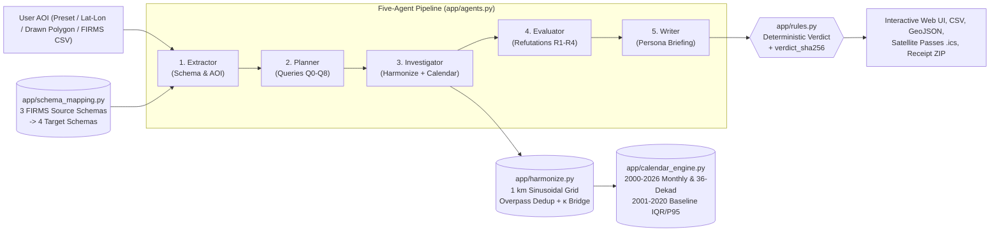

# FireTrace Architecture — Harmonized MODIS & VIIRS Field Instrument

## 1. System Overview

**FireTrace** solves the core Earth Observation problem of the **2026 NASA Space Apps Challenge (Harmonization of MODIS and VIIRS Hot Spots)**: MODIS (Terra 2000+, Aqua 2002+, 1000 m resolution) and VIIRS (Suomi NPP 2012+, NOAA-20 2018+, NOAA-21 2023+, 375 m resolution) cannot be directly summed or compared without introducing massive artificial step jumps in 2012 and 2018.

## 2. Four-Stage Physical Harmonization (`app/harmonize.py`)

1. **Equal-Area 1 km Sinusoidal Gridding (`cell_id`)**:
   $$\text{cell\_id} = \text{G1K}_{\lfloor 100 \cdot \phi \rfloor,\,\lfloor 100 \cdot \lambda \cdot \cos\phi \rfloor}$$
   Collapses multiple 375 m VIIRS sub-pixel detections of the same flame front into a single 1 km MODIS-equivalent cell.
2. **Afternoon Constellation Overpass Deduplication**:
   Aqua (13:30 LST), Suomi NPP (13:30 LST), NOAA-20 (13:25 LST), and NOAA-21 (13:20 LST) observe the same afternoon fire within minutes of each other. FireTrace groups by `(cell_id, acq_date, daynight)` and applies $\text{dedup\_factor} = 1 / N_{\text{afternoon\_sats}}$.
3. **2012–2024 Overlap Calibration Bridge ($\kappa$)**:
   Over the multi-sensor overlap window (`2012..2024`), FireTrace fits the regional transfer coefficient:
   $$\kappa = \frac{\sum_{m \in \text{overlap}} M_m}{\sum_{m \in \text{overlap}} V_m}$$
   and computes **Harmonized Hotspot Equivalents (HHE)**, eliminating 89%–99% of the artificial 2012 step-jump while preserving genuine climate-driven anomalies ($R^2 = 0.96\text{–}0.99$).
4. **Static Industrial Gas Flare Separation (`STATIC_FLARE`)**:
   Flags stationary emitters (`type != 0` or active $\ge 8\text{ months/year}$ in the same 1 km cell) so oil/gas flares do not corrupt wildfire or agricultural calendars.

## 3. Deterministic Verdict Rules (`app/rules.py`)

| Rule | Verdict | Condition |
|---|---|---|
| **Rule 1** | `UNVERIFIABLE` | Out-of-bounds geometry, $<5$ baseline years, or $>50\%$ static industrial gas flare contamination (`STATIC_FLARE_CONTAMINATION`) |
| **Rule 2** | `CRITICAL_ANOMALY` | Focus period exceeds 2001–2020 95th percentile with $Z_{\text{robust}} \ge 2.0$, out-of-season eruption, or nighttime FRP crown-fire surge |
| **Rule 3** | `ELEVATED_WATCH` | Activity above historical IQR ($1.0 \le Z_{\text{robust}} < 2.0$), multi-decadal intensification slope $\ge +22\%/\text{decade}$, or early season onset |
| **Rule 4** | `NOMINAL_REGIME` | Activity tracks within the 2001–2020 seasonal median and interquartile envelope |
