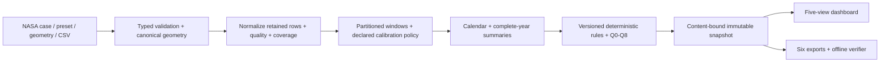

# FireTrace architecture

A single Python 3.11/FastAPI process serves a zero-build, offline-capable dashboard
and deterministic analysis pipeline. The historical five-agent names describe
ordinary code stages, not LLM calls or autonomous network agents.

| Responsibility | Code |
| --- | --- |
| Strict options/HTTP contracts | `app/models.py`, `app/http_limits.py` |
| Full geometry, holes, dateline, canonical IDs | `app/geometry.py`, `app/canonical.py` |
| CSV ingestion / generated fixtures | `app/datasets.py` |
| Pinned NASA case / offline subset rebuild | `app/case_studies.py`, `scripts/build_firms_case.py`, `app/data/` |
| Missing measurements and sensor aliases | `app/schema_mapping.py` |
| Published logical schemas | `app/schema_manifest.py` |
| Observation identities and anchored windows | `app/observations.py` |
| Applied sensor bridge, temporal policy and held-out assessment | `app/harmonize.py`, `app/calibration.py` |
| Coverage, reference statistics and phenology | `app/calendar_engine.py`, `app/stats.py` |
| Decision / evidence relationships | `app/rules.py`, `app/evidence.py` |
| Orchestration / scenarios / identity | `app/agents.py`, `app/run_state.py` |
| Snapshot-derived land-manager brief | `app/manager_brief.py` |
| Shared mission references / modeled passes | `app/satellites.py`, `app/geo_passes.py` |
| Copied, locked, bounded snapshots | `app/run_store.py` |
| Complete CSV/GeoJSON/ICS/receipt/ZIP | `app/exports.py`, `app/receipt.py`, `verify.py` |
| HTTP routing | `app/api.py` |
| UI orchestration and focused modules | `app/web/static/app.js`, `app/web/static/js/` |

A run ID binds full AOI, source rows, normalized input summary, options,
calculation-source digest, explicit reference and lineage. Counterfactuals create
new states from retained sources. The median scenario changes only an explicitly
hypothetical metric and its derived summaries; it preserves observed rows,
counts, power and reference climatology. API responses omit private source
records, while the saved audit ZIP contains retained input for reproduction.
Actual cases additionally bind the manifest, subset and fixed training policy;
the matching held-out report uses exactly the applied model. Partitioning
precedes clustering. The reference history is independent of displayed years.

The in-memory LRU is limited to 16 runs/64 MiB, copies on entry/exit and rejects
same-ID/different-content writes. Analysis/upload work runs outside the ASGI
loop. Body limits bound parsing. There is no authentication, shared-user
isolation, durable database or background live ingestion.

The browser cancels superseded requests and also checks a revision counter.
Responses from earlier selections cannot overwrite current state. DOM content is
constructed as text, source labels remain visible, plots provide text/table
alternatives, and calendar cells use one keyboard entry with arrow navigation.
Design tokens generate CSS and the standalone preview; schema declarations
generate the mapping document. No CDN is required.

See [science and model limits](SCIENCE.md), [input contracts](INPUTS.md),
[receipt scope](RECEIPTS.md), [exports](EXPORTS.md), and
[design rationale](../DESIGN.md).
